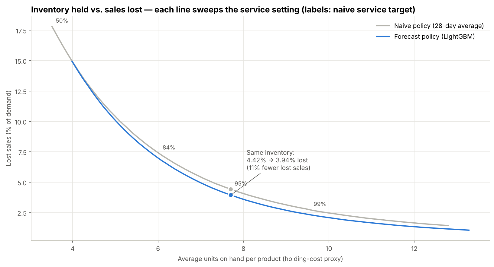
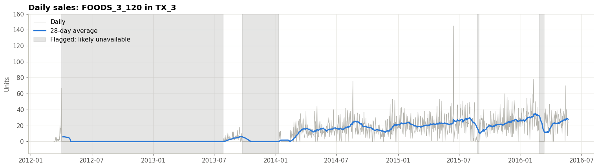

# Demand forecasting to inventory decisions (Walmart M5)

I wanted a forecasting project where the end product is a decision a store could act on, so this one answers a simple question: how much of each product should each store keep on the shelf?

Using Walmart's M5 data for 3 Texas stores and 3,566 grocery products, I forecast daily demand with LightGBM, turned those forecasts into a restocking rule, and replayed 12 weeks of real sales to see what happens. Holding the same amount of inventory, the forecast-driven policy lost 11% fewer sales than a policy based on a 28-day moving average.



## Why this problem

Every restocking decision has two ways to go wrong. If a store orders too little, the shelf goes empty and the customer leaves without buying. If it orders too much, money sits in the back room and food spoils. A better forecast only matters if it changes that trade-off, so I measured success in lost sales and inventory instead of stopping at a forecast error score.

## Results

All numbers come from a rolling backtest over 12 weeks (Feb 29 to May 22, 2016). The models never saw any data from after the day each forecast was made.

Forecast accuracy, daily and per product-store, 28 days ahead:

| | Seasonal naive | 28-day moving average | LightGBM |
|---|---|---|---|
| RMSE (mean forecast) | 3.08 | 2.46 | 2.34 |
| MAE (median forecast) | 1.48 | 1.22 | 1.11 |
| P90 coverage (target 90%) | n/a | 89.4% | 90.5% |

That's roughly 25% better than seasonal naive and 5 to 9% better than the moving average, which was the strongest baseline. LightGBM beat the moving average in each of the three test periods.

Inventory simulation, both policies holding the same average inventory:

| | Naive policy | Forecast policy |
|---|---|---|
| Lost sales (share of demand) | 4.42% | 3.94% |
| Value of lost sales per day | $692 | $609 |

Put the other way, the forecast policy needs 4.6% less inventory to match the naive policy's lost-sales rate. The gain held up in every 4-week test period (10.2% to 11.0%), and it got bigger at higher service targets, from about 5% at an 80% target to about 14% at 98%.

The two policies use the same restocking rule, the same safety stock spread and the same information date. The only thing that differs is where the expected demand comes from, so the improvement can be credited to the forecast.

## How it works

The project is four notebooks, run in order.

1. [Data prep](notebooks/01_data_prep.ipynb). The raw files are about 1.4 GB, so I filtered to Texas and FOODS first and only then reshaped the data into one row per product, store and day (8.4M rows). Switching to compact data types brought it under 200 MB. Calendar and price data are joined with validated many-to-one merges, and I dropped the days before each product launched after checking they had zero sales.
2. [Exploratory analysis](notebooks/02_eda.ipynb). Sunday sells about 39% more than a typical Tuesday to Thursday, and more than half of all product-days have zero sales. A lot of those zeros turned out to be empty shelves rather than zero demand (more on that below).
3. [Forecasting](notebooks/03_forecasting.ipynb). One LightGBM model covers every product. It uses a Tweedie loss, which suits counts with lots of zeros, and two quantile models give a P50 and a P90 for each day. Every feature is measured as of the Monday the forecast is made, and an assertion in the notebook checks this, so the model can't peek at the future.
4. [Inventory simulation](notebooks/04_inventory_simulation.ipynb). Each product gets a delivery on Monday and Thursday that tops the shelf up to expected demand until the next delivery, plus z × σ × √days of safety stock. Demand the shelf can't cover is lost, and leftovers carry over. I sweep z to trace a full trade-off curve for each policy and compare them at equal inventory, since holding more stock always reduces stockouts.

## What I found along the way



Sales data only shows what customers bought, which is not the same as what they wanted. The product above sells around 25 units a day once it's established, but it shows more than a year of zeros while it still had a price in Walmart's system. If a model learns from those zeros, it under-forecasts, the store under-orders, and the stockouts get worse. To catch this, I estimate how often each product normally sells and flag any zero streak that is very unlikely to happen by chance (less than 1 in 10,000). My first version of this rule counted units and flagged far too much, because slow products sell in clumps. Counting selling days fixed that. I checked the revised rule on simulated data with stockouts I planted myself, and by spot checking random products. It flags about 1.06M product-days, which are left out of training and scoring.

There's also a storm in the data. On June 15, 2015, all three stores roughly doubled their usual sales, then dropped below normal for the next two days. That was the day before Tropical Storm Bill made landfall in Texas, so people bought earlier rather than buying more overall.

One idea didn't work. I expected the quantile forecasts to make better safety stock than a simple 28-day standard deviation, but they did worse (a 6 to 10% gain versus 11%). Daily quantiles are coarse when most days are zero, and the P50 is often exactly 0. I kept the quantiles for showing risk on individual products and used the simpler spread for ordering.

## Limitations

- Demand here is observed sales, which were themselves limited by Walmart's real stock levels.
- Forecasts are made up to 3.5 weeks before a delivery, but the simulation has no supplier lead time beyond that. It also ignores spoilage, case packs and shelf space.
- I left out the 745 of 4,311 products that had a likely stockout during the test window, because their true demand is unknown.
- The mean forecast runs about 5.5% above observed sales, since it predicts demand for days when the product is actually on the shelf. Comparing policies at equal inventory keeps that offset from inflating the result.
- This covers 3 stores, one category and 12 test weeks, so I wouldn't generalize the exact numbers.

## Repository layout

```
notebooks/   01_data_prep, 02_eda, 03_forecasting, 04_inventory_simulation
app/         Streamlit dashboard and the small data files it reads
reports/     figures used in the notebooks and this README
data/        not committed; notebook 01 rebuilds it from Kaggle
```

## Running it yourself

1. Accept the [M5 competition rules](https://www.kaggle.com/competitions/m5-forecasting-accuracy/rules) on Kaggle and save your API token in Colab Secrets as `KAGGLE_API_TOKEN`.
2. Run the notebooks in order in Google Colab. They read from and write to `MyDrive/m5-inventory/`. Notebook 03 takes about 10 minutes, and the others take a few minutes each.
3. To run the dashboard locally: `pip install -r requirements.txt`, then `streamlit run app/streamlit_app.py`.

Built with Python, pandas, LightGBM, matplotlib and Streamlit. The data is from the [M5 Forecasting competition](https://www.kaggle.com/competitions/m5-forecasting-accuracy) on Kaggle.

Afeef Ahmed Shaikh, [afeefshaikh.com](https://afeefshaikh.com)
